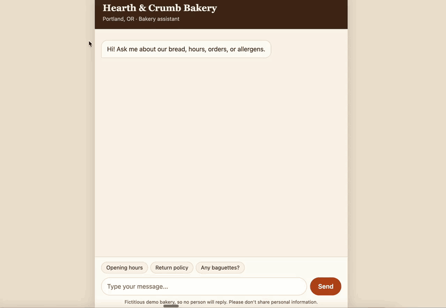
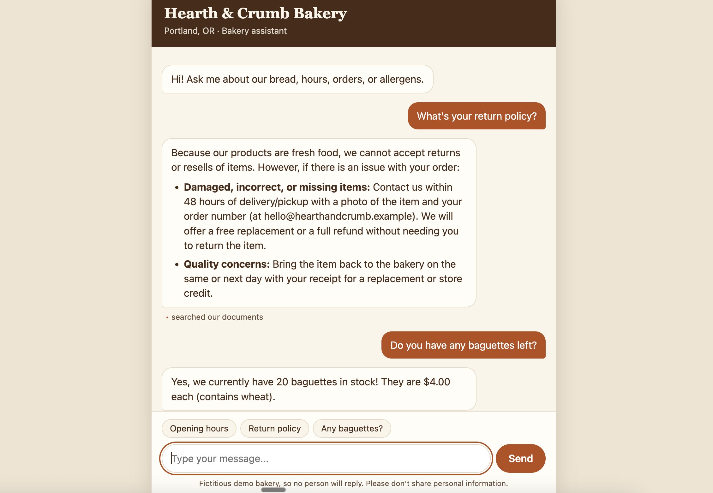
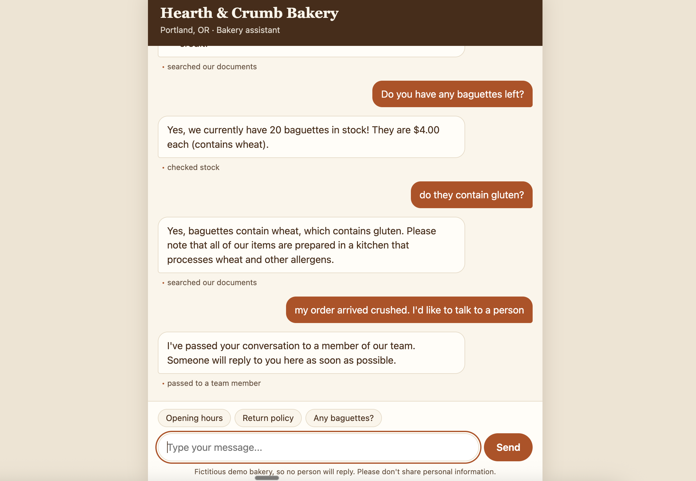
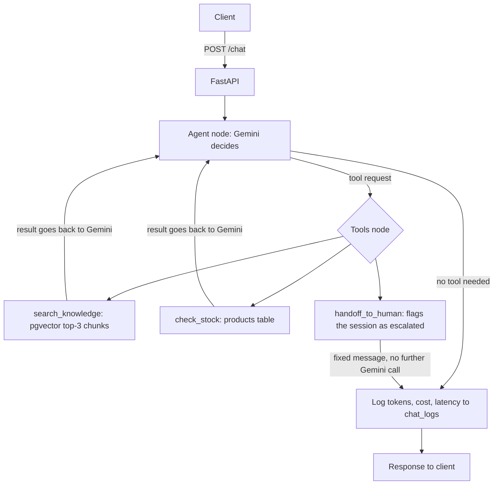

# RAG Customer Support Agent

A customer-support agent for a fictitious bakery, Hearth & Crumb. It answers questions from the bakery's own documents, checks live inventory, and hands off to a human when it can't resolve something. I built it as a portfolio project covering retrieval-augmented generation, a tool-using agent, evaluation, cost and latency tracking, and a real deploy.

**Live demo:** https://rag-customer-support-agent-f85i.onrender.com

**API docs:** https://rag-customer-support-agent-f85i.onrender.com/docs

**Status:** deployed and working. A full `/chat` turn is confirmed on the public URL, with its metrics logged.

> The demo runs on Gemini's free tier and can run out of quota. If `/chat` returns a 503, please try again later.

## Demo



Shown at 2x speed. [Watch it at real speed](assets/demo.mp4).

| Answering from the documents | Follow-up and handoff |
|---|---|
|  |  |

## How it works



It's a loop, not a fixed pipeline: after each tool result, Gemini decides whether to call another tool or answer.

## Tech stack

| Layer | Choice |
|---|---|
| API | FastAPI |
| Agent | LangGraph |
| Chat model | Gemini `gemini-3.6-flash` |
| Embeddings | Gemini `gemini-embedding-001`, 768 dimensions |
| Vector store and data | Supabase (Postgres with `pgvector`) |
| Deploy | Docker on Render |

## Try it

Open the [chat page](https://rag-customer-support-agent-f85i.onrender.com). A small label under each reply shows which tool the agent used. You can also use the [Swagger UI](https://rag-customer-support-agent-f85i.onrender.com/docs) or call the API directly:

```bash
curl -X POST https://rag-customer-support-agent-f85i.onrender.com/chat \
  -H "Content-Type: application/json" \
  -d '{"message": "Do you have any baguettes left?"}'
```

To continue a conversation, send the returned `session_id` with your next message.

## Evaluation

Results from one run of `evals/run_evals.py` on 2026-11-02. Scoring is deterministic: results are compared to known answers, with no LLM acting as judge.

| Metric | Result | What it measures |
|---|---|---|
| Retrieval recall@1 | 19/20 (95%) | The top chunk comes from the expected document |
| Retrieval recall@3 | 20/20 (100%) | The expected document is in the top 3 chunks |
| Tool-choice accuracy | 20/20 (100%) | Gemini's first tool request matches the expected tool |

**How to read these numbers:**
- **Recall@3 is saturated.** With only 6 documents and 3 slots, it says little, which is why I added recall@1.
- **The one recall@1 miss is a truly ambiguous question.** "I need to cancel my daughter's birthday cake. Do I get my money back?" ranked `returns-and-refunds.md` above the expected `custom-orders.md`.
- **Tool choice has no deliberately ambiguous cases and only one run.** `gemini-3.6-flash` ignores the `temperature` setting, so results can vary between runs.
- **It tests routing only.** It doesn't check tool arguments, conversation history, or the quality of the final reply.

## Cost and latency

Each `/chat` turn writes one row to `chat_logs` with tokens, estimated cost, latency, tools used, and whether it escalated. One real local turn with `search_knowledge`:

| Input tokens | Output tokens | Estimated cost | Latency |
|---|---|---:|---:|
| 1272 | 212 | $0.001749 | 7.5 s |

This is one sample, not an average. The cost is what the turn would cost on the paid tier, at $0.75 per 1M input tokens and $3.75 per 1M output tokens. Those prices double on 2027-01-01. It excludes the embedding call and any cache discount.

## Design decisions

- **No message text in `chat_logs`.** Anyone can type personal data into a public chat, and the metrics don't need it.
- **Conversation memory stays in RAM.** A Postgres checkpointer would survive restarts, but it would store message text in the database.
- **`/chat` is public with no auth, deliberately.** Recruiters can try it without a key. This is acceptable only because the tools read data, the data is fictitious, and the free tier cannot run up a bill. Auth or a usage cap must come before enabling billing.
- **A logging failure never costs the customer a reply.** It's reported in the server log, and the metrics for that turn are lost.
- **Tool results are treated as data, not instructions.** The system prompt tells the agent to ignore instructions found inside them.

## Known limitations

- **Quota:** the free tier allows 5 chat requests per minute and 20 per day, per project and model. A turn with a tool uses at least 2 requests, and anyone can use up the quota.
- **Memory:** a restart loses conversations, and memory isn't shared between server instances.
- **Failed turns:** a turn that fails isn't logged.
- **Retrieval:** there's no similarity threshold, so search always returns 3 chunks, even for unrelated questions.
- **Pricing:** prices are hardcoded in `app/telemetry/chat_log.py`.

## Run it locally

You need [uv](https://docs.astral.sh/uv/), a [Gemini API key](https://aistudio.google.com/), and a Supabase project.

1. Run `supabase/schema.sql` in the Supabase SQL editor.
2. Install dependencies and add your credentials:
   ```bash
   uv sync
   cp .env.example .env
   ```
3. Load the documents and products:
   ```bash
   PYTHONPATH=. uv run python scripts/ingest.py
   PYTHONPATH=. uv run python scripts/seed_products.py
   ```
4. Start the API:
   ```bash
   uv run uvicorn app.main:app --reload
   ```

Other commands:

```bash
uv run pytest -q                                    # tests, no network calls
uv run python -m evals.run_evals --retrieval-only   # retrieval metrics
uv run python -m evals.run_evals                    # all metrics, uses the daily chat quota

docker build -t rag-support-agent .
docker run -p 8000:8000 --env-file .env rag-support-agent
```

All bakery data in this project is fictitious.

## License

[MIT](LICENSE)
